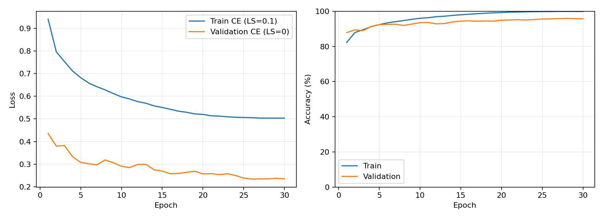
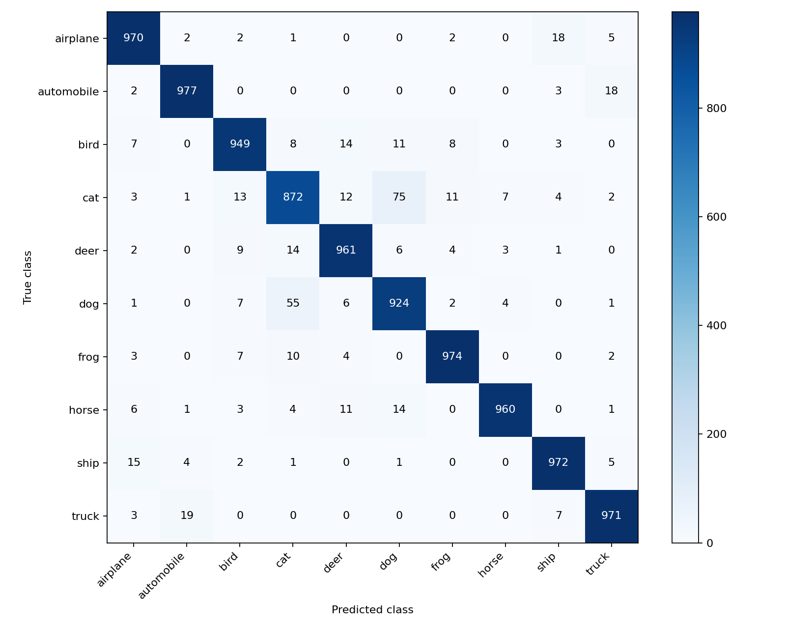

# Cifar10Lab

使用 **ImageNet-1K 预训练 ResNet-18** 完成 CIFAR-10 图像分类，在 NVIDIA GeForce RTX 2050（4GB 显存）上完成 30 轮微调。

**最终测试准确率为 95.30%，Macro F1 为 0.9530。** 最佳模型由验证集选出，对应第 28 轮。训练与最终测试均已完成。

## 实验结果

| 指标 | 结果 |
|---|---:|
| 最佳模型轮次 | 28 / 30 |
| 最佳验证准确率 | 95.92% |
| 最终测试准确率 | 95.30% |
| 测试 Macro Precision | 0.9531 |
| 测试 Macro Recall | 0.9530 |
| 测试 Macro F1 | 0.9530 |
| 测试交叉熵 | 0.2489 |
| 测试样本数 | 10,000 |
| 随机种子 | 42 |

指标来自 [results.json](experiments/cifar10_resnet18_imagenet_s42/results.json)，每轮记录见 [metrics.csv](experiments/cifar10_resnet18_imagenet_s42/metrics.csv)。30 轮训练与验证的累计计时约 **2.13 小时**，不含安装、下载、运行检查、最终测试及每轮保存和绘图等时间。

本项目只进行一个模型、一个随机种子的正式实验，未统计重复运行的均值和方差。模型使用外部 ImageNet 预训练，比较其他方法时应保持预训练与数据划分条件一致。

### 训练曲线



训练损失使用 label smoothing=0.1，验证损失使用普通交叉熵，两者绝对值不宜直接比较；准确率的计算方式一致。

### 测试混淆矩阵



行表示真实类别，列表示预测类别。每类有 1,000 张测试图片，总计 10,000 张。

### 各类别测试表现

| 类别 | 准确率 | F1 |
|---|---:|---:|
| airplane | 97.00% | 0.9642 |
| automobile | 97.70% | 0.9750 |
| bird | 94.90% | 0.9528 |
| cat | 87.20% | 0.8875 |
| deer | 96.10% | 0.9572 |
| dog | 92.40% | 0.9099 |
| frog | 97.40% | 0.9735 |
| horse | 96.00% | 0.9726 |
| ship | 97.20% | 0.9681 |
| truck | 97.10% | 0.9686 |

逐样本结果见 [predictions.csv](experiments/cifar10_resnet18_imagenet_s42/predictions.csv)。其中 confidence 表示单张图片的最大 softmax 概率。

## 项目结构

```text
Cifar10Lab/
├── configs/                 # YAML 实验配置
├── data/                    # 数据、固定划分索引与来源校验记录
├── datasets/cifar10.py      # 数据读取、分层划分与增强
├── docs/                    # 详细实验设计说明
├── evaluation/metrics.py    # 指标计算、训练曲线和混淆矩阵
├── experiments/             # 每轮日志、配置快照、权重与测试结果
├── losses/classification.py # 训练和评估交叉熵
├── models/resnet18.py       # 模型构建与 BatchNorm 统计冻结
├── scripts/train.py         # 训练与断点恢复入口
├── scripts/evaluate.py      # 最佳模型最终测试入口
├── tools/runtime.py         # 随机状态、运行环境、日志和断点工具
├── README.md
└── requirements.txt
```

## 实验设置

完整设置见 [实验配置](configs/cifar10_resnet18.yaml) 和 [运行配置快照](experiments/cifar10_resnet18_imagenet_s42/config.yaml)。

| 项目 | 设置 |
|---|---|
| 模型 | torchvision ResNet-18，IMAGENET1K_V1 预训练 |
| 分类头 | Linear(512, 10) |
| 参数量 | 11,181,642 |
| 输入 | RGB，96×96；原始图像为 32×32 |
| 数据划分 | 45,000 训练 / 5,000 验证 / 10,000 测试 |
| 训练 / 划分种子 | 42 / 42 |
| 训练轮次 | 30，无提前停止 |
| 物理 batch size | 4 |
| 梯度累积 | 8 次，完整累积组有效 batch size=32 |
| 优化器 | AdamW，weight decay=0.0005；bias 与归一化参数不衰减 |
| 基础学习率 | 主干 0.0001；分类头 0.001 |
| 学习率调度 | 前 2 轮线性 warmup，其后余弦退火 |
| 训练损失 | 交叉熵，label smoothing=0.1 |
| 评估损失 | 普通交叉熵 |
| 精度 | CUDA FP16 autocast + GradScaler |
| BatchNorm | 冻结运行统计，affine 参数仍训练 |
| 数据加载 | num_workers=0 |
| 模型选择 | 验证准确率最高；同分时选更低验证损失，再保留较早轮次 |

训练增强为原图上 RandomCrop(32, padding=4)、随机水平翻转、双线性缩放至 96×96，以及 ImageNet 均值和标准差归一化。验证和测试只缩放、转为张量并归一化，不做随机增强。96×96 是本项目的计算预算选择，不是预训练权重的默认推理分辨率。

梯度累积末组按实际样本数归一化，AMP 跳过更新时不推进学习率计数。训练前先进行 200 个 micro-batch 的运行检查，再恢复初始权重和随机状态，重新开始正式训练。

## 运行环境

已验证环境：Windows 11、Python 3.11.17、PyTorch 2.5.1+cu121、torchvision 0.20.1+cu121，GPU 为 RTX 2050 4GB。完整依赖与驱动记录见 [environment.txt](experiments/cifar10_resnet18_imagenet_s42/environment.txt)。

本机项目目录为 `D:\Projects\Cifar10Lab`，Conda 环境名为 `cifar10`，环境目录为 `D:\Python_Resources\Envs\cifar10`。其他电脑可以将项目放在自选目录；程序根据入口文件定位项目根目录。

### 首次安装

本机环境已安装完成，可直接跳到下一节。其他机器在项目根目录执行：

```powershell
conda create -n cifar10 python=3.11 pip -y
conda activate cifar10
python -m pip install -r requirements.txt
python -m pip check
```

本次配置要求可用的 NVIDIA CUDA 环境。检查：

```powershell
python -c "import torch; print(torch.__version__); print(torch.cuda.is_available())"
```

预期为 `2.5.1+cu121` 和 `True`。

### 日常操作

在 VSCode 中打开项目文件夹，使用普通 PowerShell 终端，激活环境后通过 Python 执行脚本：

```powershell
cd D:\Projects\Cifar10Lab
conda activate cifar10
```

如果新终端找不到 conda，检查是否误用了 PowerShell (No Profile)，以及 Conda 初始化脚本是否正常加载。

## 数据来源与准备

CIFAR-10 标准训练集为 50,000 张、测试集为 10,000 张。本实验按类别从训练集每类取 500 张作为验证，其余每类 4,500 张用于训练；测试集保持不变。划分索引见 [cifar10_split_seed42.json](data/cifar10_split_seed42.json)。

本次因原始下载服务器连接不稳定，使用 [uoft-cs/cifar10 数据镜像](https://huggingface.co/datasets/uoft-cs/cifar10) 的 Parquet 文件。下载文件 SHA-256 已核对，转换为 NumPy 缓存后再次记录校验值，并检查了图像形状、样本数量、每类数量及类别顺序。

本机使用的数据文件为：

```text
data/
├── train.parquet
├── test.parquet
├── cifar10_train.npz
├── cifar10_test.npz
├── data_source.json
└── cifar10_split_seed42.json
```

来源及 SHA-256 见 [data_source.json](data/data_source.json)，最终结果文件也包含这份来源记录。

代码优先读取本地 NPZ：其中 images 为 uint8、形状 `(N,32,32,3)`，labels 为整数类别；读取时核对 data_source.json 中的 NPZ 校验值。NPZ 不存在时，代码回退到 torchvision 的 CIFAR10 下载与读取接口，保留官方数据格式。原始数据和 NPZ 不需要提交到 Git 仓库；本次镜像到 NPZ 的转换尚未整理成独立命令行脚本，镜像准备过程不能仅靠训练入口自动重建。

## 训练、恢复与评估

### 新实验训练

在输出目录尚不存在时，默认配置可以直接运行：

```powershell
python scripts/train.py
```

**当前默认实验已经完成，并保留了结果目录。再次运行该命令会拒绝覆盖，这是预期行为。** 如果要重新训练，复制一份配置到 `configs/cifar10_resnet18_reproduce.yaml`，修改其中 `experiment.name` 与 `experiment.output_dir` 为新的唯一值，再执行：

```powershell
python scripts/train.py --config configs/cifar10_resnet18_reproduce.yaml
```

新配置文件需要先手动复制和修改。代码只支持当前实现的 ResNet-18 方案，不能仅修改模型名称就切换任意网络。

### 中断恢复

原实验中断且已有 last.pth 时：

```powershell
python scripts/train.py --resume
```

使用自定义配置时：

```powershell
python scripts/train.py --config configs/cifar10_resnet18_reproduce.yaml --resume
```

恢复使用相同配置与划分，从最近完整 epoch 继续，恢复优化器、GradScaler、成功更新计数、随机状态和最佳模型。未完成的一轮需要重跑。

### 最终测试

完成计划训练轮次后执行：

```powershell
python scripts/evaluate.py
```

评估读取 best.pth 与其训练配置快照，在测试集上计算指标并生成预测文件和混淆矩阵。自定义实验使用相同的 `--config` 参数指定对应配置。

**当前实验已完成最终测试。** results.json 存在时，入口会阻止重复评估，直接查看已保存的结果即可。普通训练入口不会自动调用评估；首次后台执行时使用了训练成功后再调用评估的顺序流程。

## 实验产物与仓库提交

所有本次结果保存在 `experiments/cifar10_resnet18_imagenet_s42/`。

| 文件 | 内容 |
|---|---|
| config.yaml | 实际生效配置 |
| environment.txt | 软件依赖、CUDA 与显卡驱动信息 |
| run.log | 运行检查和逐轮进度 |
| metrics.csv | 30 轮损失、准确率、学习率、耗时和显存记录 |
| best.pth | 最佳验证模型，用于评估 |
| last.pth | 最近完整轮次的训练状态，用于恢复 |
| results.json | 最终测试指标和来源记录 |
| predictions.csv | 10,000 张测试图的逐样本预测 |
| training_curves.png | 训练与验证曲线 |
| confusion_matrix.png | 测试混淆矩阵 |

代码、配置、文档、划分与来源记录、CSV/JSON 指标和 PNG 图表适合提交仓库。环境、数据、下载缓存和大权重保留在本地；best.pth 如需分发，可作为 GitHub Release 附件。当前 README 没有预设权重下载链接。

## 参考

- [CIFAR-10 数据集](https://www.cs.toronto.edu/~kriz/cifar.html)
- [本次使用的数据镜像](https://huggingface.co/datasets/uoft-cs/cifar10)
- [Torchvision ResNet-18](https://docs.pytorch.org/vision/0.20/models/generated/torchvision.models.resnet18.html)
- [实验配置说明](docs/实验配置说明.md)
